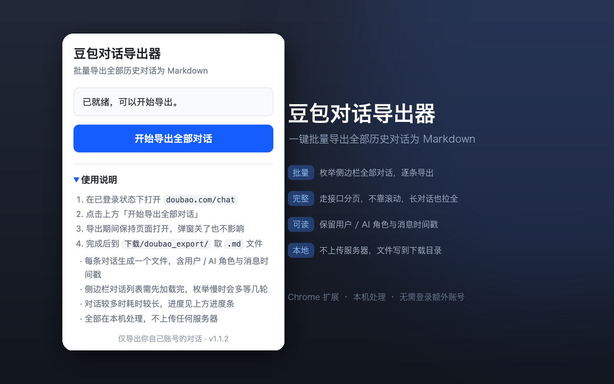

# Doubao Chat Exporter

[](https://github.com/TuringWhite/doubao_export/releases)
[](LICENSE)

[简体中文](README.md) · **English**

A Chrome extension (Manifest V3) that **bulk-exports your Doubao (豆包, ByteDance's AI assistant) web chat history to Markdown files** — one file per conversation, with roles and timestamps preserved. Everything runs locally; nothing is uploaded.



> Doubao has no official bulk-export. Copy-pasting hundreds of conversations is the only native option — that's the gap this fills.

## Quick start

| Step | What to do |
| --- | --- |
| 1 | Install the extension (see below) |
| 2 | Sign in at <https://www.doubao.com/chat> |
| 3 | Click the toolbar icon → **开始导出全部对话** (Export all conversations) |
| 4 | Find `.md` files in `Downloads/doubao_export/` |

## Install

Requires **Chrome 111+** (uses `chrome.scripting.registerContentScripts` with `world: "MAIN"`).

**Option A — download the package**

1. Grab `doubao-export-*.zip` from [Releases](https://github.com/TuringWhite/doubao_export/releases/latest)
2. Unzip it into a permanent folder (do **not** keep it in Downloads — deleting the folder breaks the extension)
3. Open `chrome://extensions/`
4. Enable **Developer mode** (top right)
5. Click **Load unpacked** and pick the unzipped folder (**not** the zip)
6. Pin the blue icon to your toolbar

**Option B — from source**

```bash
git clone https://github.com/TuringWhite/doubao_export.git
```

Then repeat steps 3–6, selecting the repo root.

## Usage

1. Open and sign in to <https://www.doubao.com/chat>
2. Click the extension icon — the popup shows "已就绪，可以开始导出"
3. Click **开始导出全部对话**
4. Wait for the progress bar; files land in `Downloads/doubao_export/`

Notes:

- **Keep the tab open** — the export runs inside the page. Closing the popup is fine; closing the tab aborts the run.
- Enumeration (scrolling the sidebar to load the full list) takes ~20s for 570 conversations; exporting takes ~3–5 min.
- A single failed conversation doesn't stop the batch; failures are listed at the end.
- Re-exporting the same conversation produces `title (1).md` instead of overwriting.

## Output format

```markdown
# How to schedule a cron job

- Conversation ID: 38453598137306114
- Messages: 4
- Exported at: 2026-11-15T21:58:12.000Z

---

## User · 2026/11/15 21:58:12

How do I run a task every day at 8am?

---

## AI · 2026/11/15 21:58:15

Use `0 8 * * *` …
```

## How it works

- The content script enumerates conversation links from the sidebar (`#flow_chat_sidebar`) — it's a virtualized list, so it scrolls in multiple rounds and stops after 3 rounds with no new items.
- `hook.js` is injected into the page's main world and hooks `fetch` to capture the page's own `/im/chain/single` requests (including `aid` / `device_id` / `web_id` params).
- For each conversation, only `conversation_id`, `anchor_index` and `direction` are overridden — so the request stays identical to what the real page sends.
- Messages are parsed from both legacy and current `content` structures; roles come from `user_type` (1 = user, 2 = assistant).
- Markdown is written to disk by the service worker via `chrome.downloads`.

## Privacy

- Requests go only to `https://www.doubao.com`, using your existing browser session.
- No backend, no telemetry, no `storage` permission. Files are written locally.
- Full policy: [PRIVACY.md](PRIVACY.md) · [online](https://turingwhite.github.io/doubao_export/privacy.html)

## Notes

- Not affiliated with, endorsed by, or authorized by Doubao / ByteDance. The name is used only to describe compatibility.
- Doubao changes its frontend often; if export breaks, open an issue with the `角色字段分布` and `失败明细` console lines.
- This tool reads data from your own account only.

MIT licensed.
