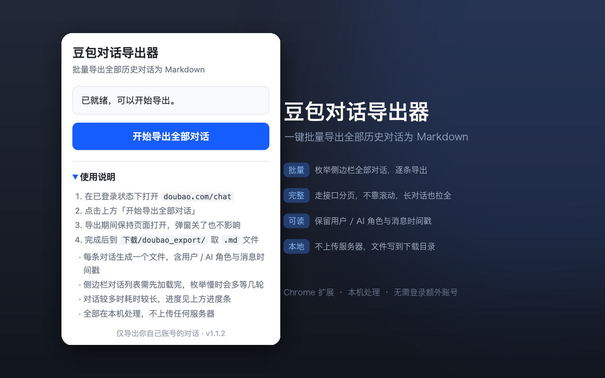

# 豆包对话导出器

[](https://github.com/TuringWhite/doubao_export/releases)
[](LICENSE)
[](https://github.com/TuringWhite/doubao_export/stargazers)
[](https://www.google.com/chrome/)

**简体中文** · [English](README.en.md)

把豆包网页版的历史对话**批量导出成 Markdown** —— 一个 Chrome 扩展（Manifest V3），全程本地处理，不上传任何服务器。



> 完整说明：[docs/使用说明.md](docs/使用说明.md)（日志逐行解读、字段踩坑记录、常见问题）
> 隐私政策：[PRIVACY.md](PRIVACY.md) · [在线版](https://turingwhite.github.io/doubao_export/privacy.html)

---

## 一分钟上手

| 步骤 | 做什么 |
| --- | --- |
| 1 | 装扩展（见下方「安装」，两种方式选一种） |
| 2 | 打开并登录 <https://www.doubao.com/chat> |
| 3 | 点工具栏图标 → 「开始导出全部对话」 |
| 4 | 到 `下载/doubao_export/` 取 `.md` 文件 |

---

## 安装

> Chrome 111 及以上（扩展用到了 `chrome.scripting.registerContentScripts` 的 `world: "MAIN"`）。
> 检查版本：地址栏输入 `chrome://version`，第一行就是。

### 方式一：下载安装包（推荐，不需要装开发工具）

1. 打开 [Releases](https://github.com/TuringWhite/doubao_export/releases/latest)，下载 `doubao-export-*.zip`
2. 解压到一个**不会被删的固定目录**，例如 `~/Documents/doubao_export`
   ⚠️ 别放在「下载」里随手清空——加载后如果目录被删，扩展会失效
3. 地址栏输入 `chrome://extensions/`
4. 打开右上角的 **开发者模式**
5. 点 **加载已解压的扩展程序**，选择第 2 步解压出来的文件夹（**不是 zip 本身**）
6. 工具栏出现蓝色气泡图标即成功；建议点拼图图标把它固定到工具栏

### 方式二：从源码加载（想改代码 / 跟进最新提交）

```bash
git clone https://github.com/TuringWhite/doubao_export.git
```

然后重复上面第 3～6 步，选中仓库根目录。

### 安装后没图标？

- 点浏览器右上角的拼图图标 🧩，在列表里找到「豆包对话导出器」，点旁边的图钉固定
- 如果 `chrome://extensions/` 里显示红色「错误」，展开看提示；多数是选错了文件夹（应该选包含 `manifest.json` 的那一层）

---

## 使用

### 前置条件

- 已在浏览器里**登录豆包**（扩展复用你当前的登录状态，不需要单独授权）
- 当前标签页是豆包对话页：`https://www.doubao.com/chat` 或 `/chat/数字ID`

### 四步导出

1. 打开 <https://www.doubao.com/chat>
2. 点工具栏的扩展图标，弹窗显示「已就绪，可以开始导出」
3. 点 **开始导出全部对话**
4. 等进度条走完，到 `下载/doubao_export/` 取文件

### 过程中会发生什么

| 阶段 | 表现 | 大概耗时 |
| --- | --- | --- |
| 枚举 | 侧边栏自动滚动，加载全部对话；控制台打印 `枚举第 N 轮: 累计 M 条` | 570 条约 20 秒 |
| 导出 | 弹窗进度条按 `已完成/总数` 前进，控制台逐条打印条数与角色分布 | 570 条约 3～5 分钟 |

- **保持页面打开**。导出逻辑跑在页面里，关掉标签页会中断；关掉弹窗不影响。
- 单条对话失败不会中断整批，失败的会记录在最后的 `失败明细` 里。
- 中途想停下：直接关标签页即可，已导出的文件不会丢。

### 文件去哪了

- 位置：浏览器默认下载目录下的 `doubao_export/` 子目录
- 命名：对话标题，例如 `如何配置定时任务.md`；标题过长会截断到 60 字，非法字符替换为 `_`
- 重复导出同名对话会生成 `如何配置定时任务 (1).md`，**不会覆盖**原文件

导出的文件长这样：

```markdown
# 如何配置定时任务

- 对话 ID: 38453598137306114
- 消息数: 4
- 导出时间: 2026-11-15T21:58:12.000Z

---

## 用户 · 2026/11/15 21:58:12

怎么用 cron 配置每天早上 8 点的任务？

---

## AI · 2026/11/15 21:58:15

可以用 `0 8 * * *` …
```

`## 用户` / `## AI` 二级标题可以直接用 Obsidian、Typora 的大纲视图跳转。

---

## 它能做什么

- 一键枚举侧边栏**全部**历史对话（实测 570 条一次性导出成功，0 失败）
- 逐条分页拉取完整历史，按 `index_in_conv` 排序，跨页重复消息自动去重
- 兼容普通对话 `/chat/:id` 与智能体对话 `/chat/bot/chat/:id`（两者首屏分页参数不同）
- 复用页面已登录状态，不需要账号密码，也不保存 Cookie
- 实时进度 + 失败明细，单条失败不影响整体
- 全程本地处理：请求只发往 `www.doubao.com`，文件只写本地下载目录

---

## 常见问题

| 问题 | 原因与处理 |
| --- | --- |
| 枚举出的对话数偏少（如只有几条） | 侧边栏没加载完。已改为「连续 3 轮无新增才停」，仍偏少就刷新页面重试，或先手动滚一下侧边栏 |
| 导出到一半停了 | 页面被关闭或刷新。重新打开页面再点一次，已导出的文件还在 |
| 所有消息都标成 AI / 都标成用户 | 角色判定失效，豆包改了字段。看 F12 里的 `角色字段分布`，然后提 [Issue](https://github.com/TuringWhite/doubao_export/issues/new/choose) |
| 文件名重复出现 `(1)` | 同名对话重复导出，浏览器自动加的，不覆盖原文件 |
| 会不会被封号 | 走页面自身接口，间隔 50ms；570 条实测未触发风控。上千条建议分批 |
| 数据会上传吗 | 不会。没有后端、没有埋点、没有 `storage` 权限 |

更多排查方法见 [docs/使用说明.md](docs/使用说明.md#八常见问题)。

---

## 工作原理

- 内容脚本运行在豆包页面同源环境，枚举侧边栏 `#flow_chat_sidebar` 中的全部对话链接（虚拟列表，滚动多轮收集）
- 通过 `hook.js` 在页面主世界注入 fetch 钩子，捕获页面自身发起的 `/im/chain/single` 请求（含 aid / device_id / web_id 等会话参数）
- 对每条对话仅覆盖 `conversation_id`、`anchor_index`、`direction` 分页拉取历史，因此与线上版本保持一致，不依赖硬编码参数
- 解析消息（兼容新旧两种 `content` 结构），按 `user_type` 判定角色（1 = 用户，2 = 助手）
- 格式化 Markdown 后交由后台 Service Worker 通过 `chrome.downloads` 写入文件

## 目录结构

```
doubao_export/
├── manifest.json              # MV3 清单
├── background.js              # Service Worker：下载文件、注册主世界钩子
├── content.js                 # 核心：枚举 + 分页 + 解析 + 格式化
├── hook.js                    # 主世界 fetch 钩子，捕获页面真实请求
├── popup.html/js/css          # 弹窗 UI 与进度
├── icons/                     # 16/32/48/128 图标
├── test.js                    # 单元测试（9 组，node test.js）
├── scripts/build.sh           # 一条命令打包上架 zip
├── scripts/check-manifest.py  # 校验 manifest 引用的文件是否齐全
├── docs/                      # 使用说明、GitHub Pages（index / privacy）
├── store/                     # 商店素材与上架文案
└── PRIVACY.md                 # 隐私政策
```

## 开发与测试

```bash
node test.js                        # 单元测试，9 组全绿
python3 scripts/check-manifest.py   # manifest 引用完整性校验
bash scripts/build.sh               # 生成 dist/doubao-export-<version>.zip
```

CI 在每次 push / PR 时自动跑前两项（Node 18 / 20 / 22）。

---

## 版本记录

### 1.1.2

- 角色判定收敛：用 570 条对话 / 300 条消息样本确认，唯一有效字段是 `user_type`（1 = 用户，2 = 助手）；
  `sender_type`、`role`、`message_type` 全部 undefined，`bot_reply_message_id` 在 300/300 条消息上都存在（零区分度）。
  移除 `bot_reply_message_id` 作为助手标记的判定，避免再次整篇误判。
- 新增 [docs/使用说明.md](docs/使用说明.md)：含实拍截图、日志逐行解读、角色判定踩坑记录与常见问题。

### 1.1.1

- 修复角色判定优先级：`reply_id`（引用回复）用户消息也会带，旧逻辑把它当成助手标记，导致整篇被判成 AI。
  现在用户侧标记（`sender_type`/`user_type` = 1、`from_user_id`、`sender.user_id`）排在 `bot_reply_message_id` 之前，
  `reply_id` 不再参与判定。
- 修复侧边栏枚举：原来滚一次等 400ms 就判定「没有新增」，侧边栏稍慢就只拿到当前可见的几条（实测只枚举到 5 条而实际有几百条）。
  现在每轮滚动所有可滚动容器、等 600ms，连续 3 轮无新增才收手，并打印每轮累计数。
- 增加角色诊断：导出时打印首条/第二条消息的角色相关字段，结束时打印字段取值分布，接口改版可一眼定位。

### 1.1.0

- 修复角色判定：旧版按 `user_type === 0` 判断用户，导致 409 个导出文件里用户消息全部被标成 AI。
  改为多字段兜底，判不出来记为「未识别」，并在文件头与控制台给出提示。
- 修复文件名/标题重复：侧边栏是虚拟列表，`textContent` 会拼出 `标题标题标题`，现做重复段还原、去杂符并截断到 60 字。
- 补 `icons/`（16/32/48/128）并在 manifest 中声明。
- 智能体对话（`/chat/bot/chat/:id`）改用 `anchor=0 + direction=3` 首屏探测，普通对话用 `MAX_SAFE_INTEGER + direction=1`，失败自动换候选。
- 观测不到页面请求时自拼 `/im/chain/single` URL 并补齐默认 query，不再直接报错。
- 分页改用 `has_more` 判终止，锚点优先取接口返回的 `next_anchor`，并加 `seenAnchors` + 重复页 + 消息 ID 三重去重。
- 单元测试扩到 9 组，`node test.js` 全绿。

### 1.0.0

- 首个版本：枚举侧边栏会话、按页拉取历史、导出 Markdown。

## 开源说明

本项目以 MIT 协议开源，见 [LICENSE](LICENSE)。

**为什么开源**：这类工具要读取你账号里的聊天内容，闭源插件无从验证它把数据发去了哪里。代码摊开放在这里，`content.js` 里所有请求都只发往 `www.doubao.com`，你可以自己 grep 一遍再决定装不装。

**接口会变**：豆包改版是常态，导出失败大多不是"坏了"，而是字段或分页参数变了。提 issue 时请附上控制台里的两类日志：

```
[豆包导出] 角色字段分布: {...}
[豆包导出] 失败明细: [...]
```

有了这两行，改 `inferRole()` / `fetchPage()` 基本是几分钟的事。把 `user_type`、`sender_type` 这些字段的实际取值贴出来，比重启十次页面有用。

**贡献**：fork → 改 → `node test.js` 全绿 → 提 PR。涉及角色判定或分页逻辑的改动，请同时补一条回归用例（`test.js` 里已有现成结构可抄）。

## 免责声明

- 本扩展不是豆包、字节跳动或其关联公司的官方产品，未获得其授权、合作或背书。"豆包"等名称仅用于说明兼容的网站。
- 扩展通过豆包网页自身的接口读取**你自己账号下、你自己可见**的对话内容，不涉及他人数据。
- 请遵守你与豆包之间的服务条款。批量高频请求可能触发平台风控，由此导致的账号限制由使用者自行承担。
- 导出文件请自行妥善保管，其中可能包含个人隐私信息。
