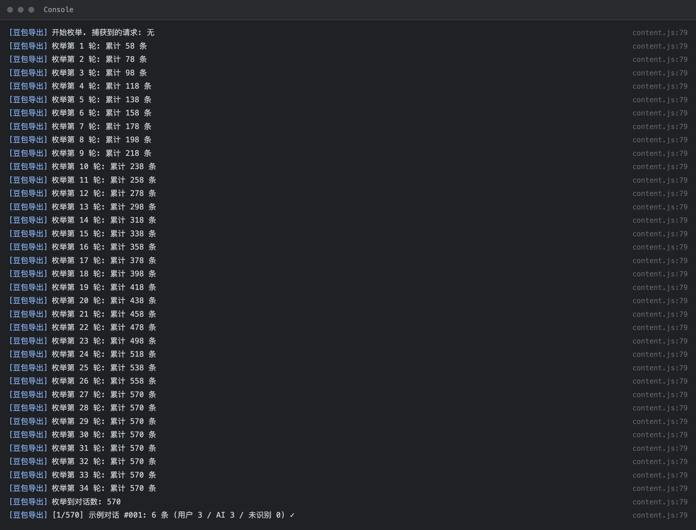
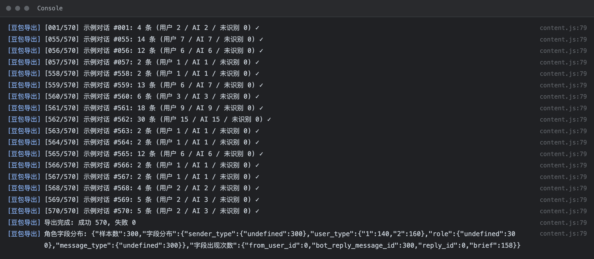

# 豆包对话导出器 · 使用说明

> 版本 1.1.2 · 最近更新 2026-11-15
> 一个 Chrome 扩展（Manifest V3），把你在豆包网页版的历史对话批量导出为 Markdown 文件。

---

## 一、它解决什么问题

豆包没有官方的「批量导出对话」入口。想备份几十上百条对话，只能一条条复制粘贴——这是本扩展要干的事：**点一次，全部导出成一个个 `.md` 文件**，带角色、带时间戳，能直接拖进 Obsidian / Typora 阅读和检索。

---

## 二、安装

### 方式一：Chrome 应用商店

在 Chrome 应用商店搜索「豆包对话导出器」，点「添加至 Chrome」。（上架后可用）

### 方式二：加载已解压的扩展（开发者模式）

1. 下载或克隆本仓库到本地
2. 打开 `chrome://extensions/`
3. 右上角打开「开发者模式」
4. 点「加载已解压的扩展程序」，选择仓库根目录
5. 工具栏出现蓝色气泡图标即安装成功

> 需要 Chrome 111 及以上（扩展用 `chrome.scripting.registerContentScripts` 的 `world: "MAIN"` 注入页面钩子）。

---

## 三、使用步骤

1. 在已登录状态下打开 `https://www.doubao.com/chat`
2. 点击工具栏的扩展图标，弹窗里点「**开始导出全部对话**」
3. 导出期间**保持页面打开**（弹窗关掉不影响，页面关掉会中断）
4. 完成后到 `下载/doubao_export/` 取文件，每条对话一个 `.md`

弹窗里内置了同样的四步说明，忘了可以随时点开看。

---

## 四、实际运行效果

以下为本机实测（570 条历史对话）的真实控制台输出。

### 4.1 枚举阶段



侧边栏是虚拟滚动列表，扩展需要反复滚到底部触发懒加载。日志里每轮打印一次累计条数：

```
[豆包导出] 开始枚举. 捕获到的请求: 无
[豆包导出] 枚举第 1 轮: 累计 58 条
[豆包导出] 枚举第 2 轮: 累计 78 条
[豆包导出] 枚举第 3 轮: 累计 98 条
...
[豆包导出] 枚举第 27 轮: 累计 558 条
[豆包导出] 枚举第 28 轮: 累计 570 条
[豆包导出] 枚举第 29 轮: 累计 570 条
[豆包导出] 枚举第 30 轮: 累计 570 条
[豆包导出] 枚举到对话数: 570
```

读法：

- 每轮稳定 +20 条，说明侧边栏一批批加载，属于正常节奏
- 数字**连着三轮不变**（29/30/31 轮）才会收手，这是为了防止"看着没新增其实还在加载"导致漏掉对话
- 每轮间隔 600ms，570 条约需 20 秒；对话越多越久

### 4.2 导出阶段



```
[豆包导出] [1/570] 示例对话 #001: 6 条 (用户 3 / AI 3 / 未识别 0) ✓
[豆包导出] [55/570] 示例对话 #055: 4 条 (用户 2 / AI 2 / 未识别 0) ✓
[豆包导出] [557/570] 示例对话 #557: 12 条 (用户 6 / AI 6 / 未识别 0) ✓
[豆包导出] [568/570] 示例对话 #568: 4 条 (用户 2 / AI 2 / 未识别 0) ✓
[豆包导出] 导出完成: 成功 570, 失败 0
[豆包导出] 角色字段分布: {
  "样本数": 300,
  "字段分布": {
    "sender_type": {"undefined": 300},
    "user_type": {"1": 140, "2": 160},
    "role": {"undefined": 300},
    "message_type": {"undefined": 300}
  },
  "字段出现次数": {"from_user_id": 0, "bot_reply_message_id": 300, "reply_id": 0, "brief": 158}
}
```

570 条对话全部成功，每条的角色都成对出现（用户 N / AI N），说明角色判定正常。

---

## 五、日志怎么读

| 日志行 | 含义 | 出现异常时怎么看 |
| --- | --- | --- |
| `捕获到的请求: 无` | 页面自身的接口请求没被抓到 | 不影响导出，扩展会自拼接口 URL |
| `枚举第 N 轮: 累计 M 条` | 侧边栏懒加载进度 | 每轮 +0 连续三轮才停；若一直不涨，说明侧边栏没滚到底部 |
| `[i/N] 标题: X 条 (用户 a / AI b / 未识别 c)` | 单条对话导出结果 | `未识别` 不为 0 说明该对话有消息字段缺失，见第七节 |
| `导出完成: 成功 X, 失败 Y` | 整批结果 | 失败明细会单独打印，单条失败不影响其他 |
| `角色字段分布` | 样本消息里各角色相关字段的取值统计 | 排查接口改版用：看哪个字段在 1/2 之间分布 |
| `警告: 全部导出里没有识别到任何用户消息` | 角色判定整体失效 | 接口字段名变了，需要按分布结果调整判定顺序 |

---

## 六、导出文件长什么样

文件名就是对话标题（重复拼接会被还原、超长截断到 60 字、非法字符替换为 `_`）：

```
下载/doubao_export/示例对话-如何导出对话.md
下载/doubao_export/示例对话-Markdown 语法.md
```

文件内容：

```markdown
# 示例对话-如何导出对话

- 对话 ID: 38453598137306114
- 消息数: 4
- 导出时间: 2026-11-14T17:20:28.262Z

---

## 用户 · 2026/11/13 15:33:48

怎么把豆包的历史对话导出成文件？

---

## AI · 2026/11/13 15:33:50

可以装一个浏览器扩展，一键导出为 Markdown。
- 每条对话一个 .md 文件

---
```

约定：

- `## 用户` / `## AI` 二级标题 + 消息时间，方便用大纲视图跳转
- 消息之间用 `---` 分隔，正文保持接口返回的 Markdown（表格、代码块、列表都不动）
- 同名对话重复导出会生成 `标题 (1).md`，不会覆盖原文件

---

## 七、角色判定是怎么做的（踩坑记录）

接口返回的消息里，跟"谁说的"有关的字段有好几个，但只有一个可靠：

| 字段 | 实测表现 | 能否用 |
| --- | --- | --- |
| `user_type` | `1` = 用户，`2` = 助手 | ✅ **唯一可靠** |
| `sender_type` | 全部 `undefined` | ❌ 不存在 |
| `role` | 全部 `undefined` | ❌ 不存在 |
| `message_type` | 全部 `undefined` | ❌ 不存在 |
| `bot_reply_message_id` | **300/300 条消息都有**，用户消息也带 | ❌ 零区分度 |
| `reply_id` | 引用回复时出现，用户消息也会带 | ❌ 不可用 |

前两版正是栽在 `reply_id` 和 `bot_reply_message_id` 上：把它们当"助手标记"，结果所有消息都命中该分支，整篇对话被标成 AI（曾经 409 个文件里 0 个用户消息）。

现在的判定顺序：

```
user_type / sender_type 为 1        → 用户
user_type / sender_type 为 2、3     → AI
is_user === true                    → 用户
role === "user" / "assistant"       → 对应角色
user_type === 0（旧结构）           → 用户
以上都不匹配                        → 未识别（文件头会标注，不静默当 AI）
```

接口再改版时，看控制台的「角色字段分布」就能定位新的区分字段，改 `content.js` 里的 `inferRole()` 即可。

---

## 八、常见问题

**Q：枚举出来的对话数明显偏少（比如只有 5 条）？**
侧边栏没加载完就收手了。1.1.1 起改为"连续三轮无新增"才停止，并滚动所有可滚动容器。如果仍偏少，把豆包页面刷新后再试，或先手动滚一下侧边栏。

**Q：导出到一半停了？**
页面被关闭或刷新了。扩展的逻辑跑在页面里，页面一关就中断。重新打开页面再点一次即可，已导出的文件不会丢，重复的会生成 `(1)` 副本。

**Q：所有消息都标成 AI / 都标成用户？**
角色判定失效，说明豆包又改了字段。打开 F12 控制台看「角色字段分布」，把那一行发给我。

**Q：会不会被封号 / 限流？**
扩展用的是页面自身的同源接口，频率由扩展控制（每页间隔 50ms）。570 条对话一次导出未触发风控，但对话量特别大（上千条）时建议分批，或把间隔调大。

**Q：导出的文件能直接导入其他工具吗？**
Markdown 是纯文本，Obsidian / Typora / Notion / 飞书文档都能直接读。想结构化处理可以改 `formatMarkdown()` 输出 JSON。

**Q：数据会上传吗？**
不会。请求只发往 `www.doubao.com`，文件只写本地下载目录，扩展没有 `storage` 权限、无任何埋点。

---

## 九、隐私与合规

- 只读取**你自己账号**在豆包网页版里的对话，不涉及其他网站
- 全程在本机完成，不经过任何第三方服务器
- 不采集账号密码、浏览记录、剪贴板
- 请只导出你有权访问和保存的内容，并遵守你与豆包之间的服务条款
- 本扩展是第三方工具，与豆包、字节跳动无关联，未获其授权或背书

完整条款见 [PRIVACY.md](../PRIVACY.md)。

---

## 十、版本记录

| 版本 | 变更 |
| --- | --- |
| 1.1.2 | 角色判定收敛：实测确认只有 `user_type`（1/2）有效，移除 `bot_reply_message_id` 误判 |
| 1.1.1 | 修复 `reply_id` 抢判、侧边栏枚举只拿到几条、增加角色字段诊断 |
| 1.1.0 | 修复角色全标 AI、标题重复、补齐图标、智能体对话锚点、分页去重 |
| 1.0.0 | 首个版本 |
